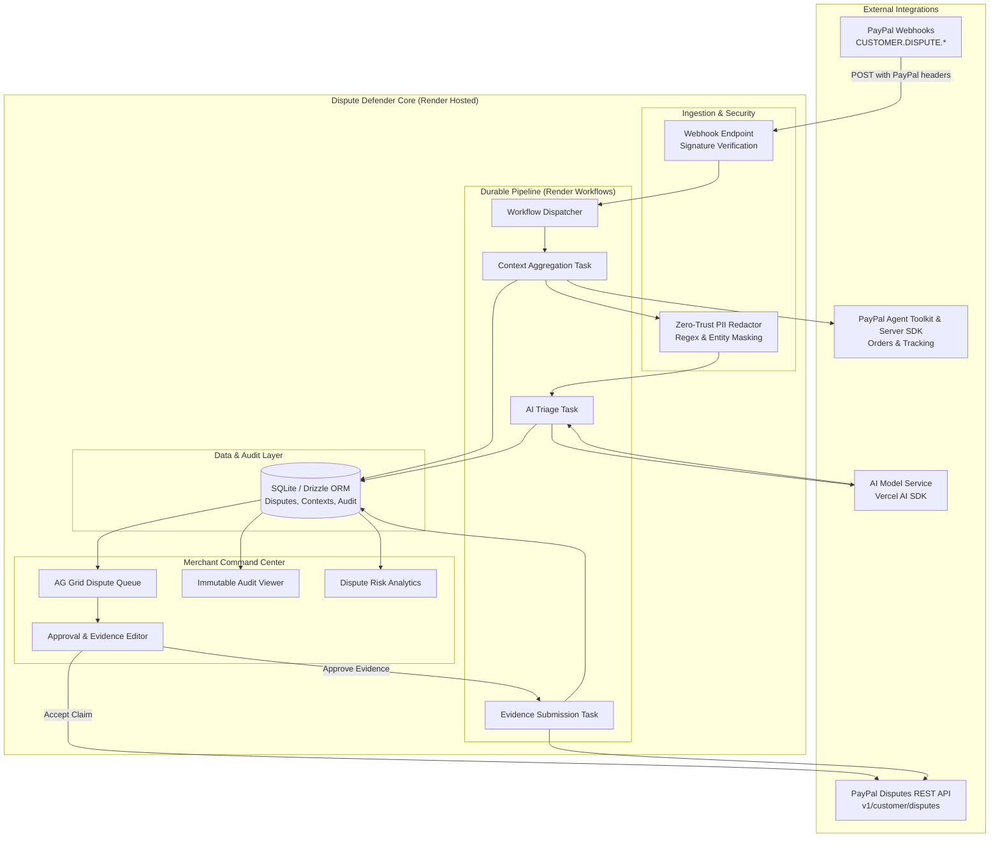

# Dispute Defender: Technical Architecture & System Specifications

**Version:** 1.0.0  
**Target Environment:** Node.js 18+ / TypeScript / Next.js 14+ / SQLite  

---

## 1. System Component Architecture



---

## 2. PayPal API Specifications & The "Missing Evidence" Gap

### The Critical Gap in the Official Agent Toolkit
The official [PayPal Agent Toolkit](https://github.com/paypal/agent-toolkit) provides tools to:
- `list_disputes`
- `get_dispute`
- `accept_dispute_claim`
- `get_order`
- `get_shipment_tracking`
- `create_shipment_tracking`

However, **it does not provide any tool to submit evidence (`provide-evidence`)**. Dispute Defender implements a custom, high-fidelity REST client that interfaces directly with PayPal's Customer Disputes REST API.

### Custom REST Client: `provide-evidence`
- **Method:** `POST`
- **Endpoint:** `https://api-m.sandbox.paypal.com/v1/customer/disputes/{dispute_id}/provide-evidence`
- **Headers:**
  - `Authorization: Bearer <ACCESS_TOKEN>`
  - `Content-Type: multipart/form-data`
- **Payload (`input` parameter inside form-data):**

```json
{
  "evidences": [
    {
      "evidence_type": "PROOF_OF_FULFILLMENT",
      "evidence_info": {
        "tracking_info": [
          {
            "carrier_name": "FEDEX",
            "tracking_number": "122533485"
          }
        ]
      },
      "notes": "Item delivered on Oct 24, 2026. Fedex tracking: 122533485 confirms delivery to customer destination before dispute filed."
    }
  ]
}
```

### Dynamic HATEOAS Link Inspection
Before calling `provide-evidence` or `accept-claim`, Dispute Defender verifies that the action is legally permissible by inspecting the `links` array returned by `GET /v1/customer/disputes/{id}`:
```typescript
export function getDisputeActionLinks(dispute: PayPalDispute) {
  const links = dispute.links || [];
  return {
    canProvideEvidence: links.some(l => l.rel === 'provide-evidence'),
    canAcceptClaim: links.some(l => l.rel === 'accept-claim'),
    canMakeOffer: links.some(l => l.rel === 'make-offer'),
    canAppeal: links.some(l => l.rel === 'appeal'),
    provideEvidenceUrl: links.find(l => l.rel === 'provide-evidence')?.href
  };
}
```

---

## 3. Webhook Signature Verification Protocol

To prevent spoofing attacks, all incoming webhooks are cryptographically validated against PayPal's verification service:
- **Endpoint:** `POST https://api-m.sandbox.paypal.com/v1/notifications/verify-webhook-signature`
- **Verification Payload:**
```json
{
  "auth_algo": "<PAYPAL-AUTH-ALGO-HEADER>",
  "cert_url": "<PAYPAL-CERT-URL-HEADER>",
  "transmission_id": "<PAYPAL-TRANSMISSION-ID-HEADER>",
  "transmission_sig": "<PAYPAL-TRANSMISSION-SIG-HEADER>",
  "transmission_time": "<PAYPAL-TRANSMISSION-TIME-HEADER>",
  "webhook_id": "<CONFIGURED-WEBHOOK-ID>",
  "webhook_event": <RAW-PARSED-EVENT-OBJECT>
}
```
If the status returned is `SUCCESS`, the payload is dispatched to the ingestion pipeline; otherwise, HTTP 401 is returned.

---

## 4. Zero-Trust PII Redaction Engine

### Redaction Rules
Dispute context is sanitized using deterministic regex and token masks before any AI invocation:

| Data Type | Detection Pattern | Replacement Token |
| :--- | :--- | :--- |
| **Buyer Email** | `[\w\.-]+@[\w\.-]+\.\w+` | `[EMAIL_REDACTED]` |
| **Buyer Phone** | `(\+?\d{1,3}[-.\s]?)?\(?\d{3}\)?[-.\s]?\d{3}[-.\s]?\d{4}` | `[PHONE_REDACTED]` |
| **Street Address** | Street keywords, digit + name patterns | `[STREET_ADDRESS_REDACTED]` |
| **Buyer Full Name** | Extracted from `dispute.disputed_transactions[0].buyer.name` | `[BUYER_NAME_REDACTED]` |
| **IP Address** | IPv4/IPv6 patterns | `[IP_REDACTED]` |

### Explicitly Preserved Data
- Order ID, Item Titles, SKUs, Transaction Amounts, Currency Codes
- Carrier Name (e.g. `USPS`, `FEDEX`, `UPS`), Tracking Number
- Carrier Status (e.g. `DELIVERED`, `IN_TRANSIT`), Event Timestamps
- Seller response due date, Dispute Reason, Life cycle stage

Both raw and redacted context bundles are stored so the merchant can inspect the exact redaction diff in the UI before approving the verdict.

---

## 5. Autonomous Triage Agent & Schema Definition

The triage agent is implemented using the **Vercel AI SDK** with structured output enforcement (`generateObject`):

```typescript
import { z } from 'zod';

export const EvidenceChecklistItemSchema = z.object({
  sourceField: z.string().describe('Exact source attribute, e.g. shipment.tracking_status or order.amount'),
  claimedFact: z.string().describe('The verified factual statement'),
  verified: z.boolean().describe('Whether this fact is confirmed by official records'),
  notes: z.string().describe('Contextual justification')
});

export const TriageVerdictSchema = z.object({
  disputeId: z.string(),
  recommendation: z.enum(['FIGHT', 'ACCEPT']).describe('FIGHT to submit evidence, ACCEPT to refund buyer'),
  confidenceScore: z.number().min(0).max(100),
  summaryReason: z.string().describe('Concise executive explanation for the merchant'),
  evidenceChecklist: z.array(EvidenceChecklistItemSchema),
  proposedDraftNotes: z.string().describe('Draft rebuttal note formatted for PayPal adjudicators'),
  evidenceTypeRequired: z.enum(['PROOF_OF_FULFILLMENT', 'PROOF_OF_REFUND', 'OTHER']),
  missingEvidenceWarnings: z.array(z.string()),
  riskAnalysis: z.string().describe('Analysis of dispute fee risk and win probability')
});

export type TriageVerdict = z.infer<typeof TriageVerdictSchema>;
```

---

## 6. Database Persistence Schema (SQLite / Drizzle ORM)

```typescript
import { sqliteTable, text, integer, real } from 'drizzle-orm/sqlite-core';

export const disputes = sqliteTable('disputes', {
  id: text('id').primaryKey(), // PayPal Dispute ID: PP-D-xxxxx
  status: text('status').notNull(), // NEEDS_TRIAGE, AWAITING_APPROVAL, SUBMITTED, ACCEPTED, CLOSED
  reason: text('reason').notNull(),
  amount: real('amount').notNull(),
  currency: text('currency').notNull(),
  dueDate: text('due_date').notNull(),
  lifeCycleStage: text('life_cycle_stage').notNull(),
  transactionId: text('transaction_id'),
  allowedOptions: text('allowed_options'), // JSON string
  rawJson: text('raw_json').notNull(),
  createdAt: text('created_at').notNull(),
  updatedAt: text('updated_at').notNull()
});

export const disputeContexts = sqliteTable('dispute_contexts', {
  id: text('id').primaryKey(),
  disputeId: text('dispute_id').notNull().references(() => disputes.id),
  orderData: text('order_data'), // JSON
  trackingData: text('tracking_data'), // JSON
  buyerMessages: text('buyer_messages'), // JSON
  redactedContext: text('redacted_context').notNull(), // JSON
  createdAt: text('created_at').notNull()
});

export const triageDecisions = sqliteTable('triage_decisions', {
  id: text('id').primaryKey(),
  disputeId: text('dispute_id').notNull().references(() => disputes.id),
  recommendation: text('recommendation').notNull(), // FIGHT | ACCEPT
  confidenceScore: integer('confidence_score').notNull(),
  summaryReason: text('summary_reason').notNull(),
  evidenceChecklist: text('evidence_checklist').notNull(), // JSON
  draftNotes: text('draft_notes').notNull(),
  merchantEditedNotes: text('merchant_edited_notes'),
  status: text('status').notNull(), // PENDING_APPROVAL, APPROVED, REJECTED
  approvedAt: text('approved_at'),
  createdAt: text('created_at').notNull()
});

export const auditLogs = sqliteTable('audit_logs', {
  id: text('id').primaryKey(),
  disputeId: text('dispute_id').notNull(),
  eventType: text('event_type').notNull(), // WEBHOOK_RECEIVED, CONTEXT_FETCHED, PII_REDACTED, TRIAGE_COMPLETED, MERCHANT_APPROVED, PAYPAL_SUBMITTED
  actor: text('actor').notNull(), // SYSTEM, AGENT, MERCHANT
  payload: text('payload').notNull(), // JSON snapshot
  timestamp: text('timestamp').notNull()
});
```
