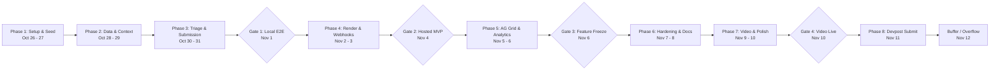

# Dispute Defender: Day-by-Day Execution Timeline & Milestone Gates

**Execution Window:** Monday, Oct 26, 2026 – Thursday, Nov 12, 2026  
**Final Submission Deadline:** Nov 13, 2026, 01:30 AM IST (Nov 12, 3:00 PM US Eastern)  
**Target Completion / Submission Date:** Wednesday, Nov 11, 2026 (24-hour safety buffer)  

---

## 1. Timeline Overview & Hour Allocation

- **Total Working Days:** 17 days
- **Estimated Commitment:** ~3 hours/weekday, ~6 hours/weekend (~65 engineering hours total)
- **Hard Feature Freeze:** Friday, Nov 6, 2026 (Gate 3)

---

## 2. Detailed Daily Milestones

### Week 1: Core Mechanics & Autonomous Logic (Oct 26 – Nov 1)

#### Monday, Oct 26 — Environment Setup & Sandbox Verification
- **Focus:** Setup developer credentials, repo structure, and SDK exploration.
- **Key Tasks:**
  - Initialize project repository structure (`plan/` and `dispute-defender/`).
  - Configure PayPal Sandbox App with Disputes scope (`https://uri.paypal.com/services/disputes/update-seller`).
  - Validate Sandbox Business and Buyer accounts.
  - Install APIMatic Context Plugin for coding agent.
- **Done When:** A test script successfully fetches an OAuth access token and lists sandbox data through the PayPal Agent Toolkit.

#### Tuesday, Oct 27 — Seed Sandbox Disputes
- **Focus:** Create reproducible dispute data in PayPal Sandbox.
- **Key Tasks:**
  - Log in to PayPal Sandbox as Buyer and initiate 5–6 disputes with varied reasons (`MERCHANDISE_OR_SERVICE_NOT_RECEIVED`, `NOT_AS_DESCRIBED`).
  - Add shipping tracking records to corresponding orders using `create_shipment_tracking`.
  - Save dispute IDs, order IDs, and transaction IDs into `dispute-defender/scripts/seed-disputes.ts`.
- **Done When:** `list_disputes` API call returns the seeded disputes; IDs stored in JSON seed file.

#### Wednesday, Oct 28 — Persistence Layer & Dispute Sync Engine
- **Focus:** SQLite database schema and dispute sync endpoint.
- **Key Tasks:**
  - Setup Drizzle ORM + SQLite for tables: `disputes`, `dispute_contexts`, `triage_decisions`, `audit_logs`.
  - Implement `syncDisputes()` routine that pulls open disputes from PayPal and upserts them into SQLite.
  - Build simple Next.js API route `/api/disputes/sync`.
- **Done When:** Hitting the sync endpoint populates the local database with all open sandbox disputes.

#### Thursday, Oct 29 — Context Aggregator & Zero-Trust Redaction Engine
- **Focus:** Assemble order context and sanitize PII before LLM consumption.
- **Key Tasks:**
  - Build `gatherDisputeContext()` to fetch related orders, carrier tracking info, and buyer messages.
  - Build `sanitizeDisputeContext()` with regex masking for emails, phone numbers, names, and physical addresses.
  - Write unit tests for redactor (`redactor.test.ts`).
- **Done When:** Unit tests pass with 100% masking of sensitive fields while preserving tracking numbers and order totals.

#### Friday, Oct 30 — Autonomous Triage Agent v1
- **Focus:** Vercel AI SDK structured prompt engineering.
- **Key Tasks:**
  - Implement `runTriageAgent()` with Zod schema (`TriageVerdictSchema`).
  - Craft strict prompts: must cite source fields for every claim; evaluate tracking status against dispute date.
  - Benchmark on the 6 seeded sandbox disputes.
- **Done When:** Model produces structured JSON with accurate `FIGHT` or `ACCEPT` verdict matching manual expert judgment on at least 5 of 6 seeded disputes.

#### Saturday, Oct 31 — Custom REST Evidence Submission Client
- **Focus:** Bridge the toolkit gap with direct multipart REST submissions.
- **Key Tasks:**
  - Implement `submitDisputeEvidence()`: generates multipart form-data with the `input` JSON payload.
  - Implement `acceptDisputeClaim()` for the refund path.
  - Test evidence submission against a sandbox dispute waiting for seller response.
- **Done When:** Evidence submitted via code appears in the official PayPal Sandbox Merchant Resolution Center.

#### Sunday, Nov 1 — Gate 1: Human-in-the-Loop Review Screen & Local E2E
- **Focus:** Build interactive approval interface.
- **Key Tasks:**
  - Build `disputes/[id]/page.tsx` displaying verdict card, evidence checklist, and editable draft notes textarea.
  - Add side-by-side Redaction Diff modal.
  - Hook up "Approve & Submit" and "Accept Claim" buttons.
- **Done When (GATE 1):** Both FIGHT and ACCEPT paths execute end-to-end locally with verified state changes in PayPal Sandbox.

---

### Week 2: Render Workflows, AG Grid & Feature Freeze (Nov 2 – Nov 6)

#### Monday, Nov 2 — Deploy on Render & Implement Webhook Ingestion
- **Focus:** Deploy web application to Render; handle live webhooks.
- **Key Tasks:**
  - Create `render.yaml` blueprint and deploy to Render.
  - Build `/api/webhooks/paypal` endpoint with cryptographic signature verification.
  - Register webhook URL in PayPal Sandbox Developer Portal for `CUSTOMER.DISPUTE.*` events.
- **Done When:** Creating a dispute in Sandbox triggers the Render webhook, logs the event, and updates the queue without manual sync.

#### Tuesday, Nov 3 — Durable Pipeline via Render Workflows
- **Focus:** Wrap pipeline steps in Render Workflows (durability-as-code).
- **Key Tasks:**
  - Implement `disputeDefenseWorkflow` (Ingest -> Aggregate Context -> Redact -> Triage -> Notify).
  - Add retry handling for transient OpenAI/Gemini or PayPal API rate limits.
- **Done When:** A new dispute progresses autonomously from creation to `AWAITING_APPROVAL` with zero clicks.

#### Wednesday, Nov 4 — Gate 2: Full Audit Trail & Hosted MVP
- **Focus:** Complete merchant transparency and hosted milestone gate.
- **Key Tasks:**
  - Build `/audit` page displaying chronological event log (Webhook -> Context -> Redaction -> Verdict -> Approval -> Submission).
  - Build Redaction Diff inspector.
- **Done When (GATE 2):** Dispute Defender is hosted live on Render; judges can inspect any verdict, its raw vs redacted inputs, and full tool calls.

#### Thursday, Nov 5 — Outcome Tracking & Sandbox State Simulator
- **Focus:** Handle dispute lifecycle resolutions and demo controls.
- **Key Tasks:**
  - Process `CUSTOMER.DISPUTE.RESOLVED` webhooks to record final outcomes.
  - Add admin simulator buttons calling sandbox `adjudicate` and `require-evidence` to easily manipulate dispute states during video recording.
- **Done When:** Settled dispute outcomes are automatically recorded and displayed.

#### Friday, Nov 6 — Gate 3: AG Grid Analytics Dashboard & Feature Freeze
- **Focus:** High-value sponsor dashboard and strict feature freeze.
- **Key Tasks:**
  - Build `/analytics` with AG Grid / AG Studio: dispute reason breakdown, amount at risk, win rate, and resolution speed.
  - Polish the main Dispute Queue with urgency badges and floating filters.
- **Done When (GATE 3):** Feature Freeze declared at 11:59 PM. Zero new features added after tonight.

---

### Week 3: Hardening, Polish, Video Production & Devpost Submission (Nov 7 – Nov 12)

#### Saturday, Nov 7 — Hardening & Edge-Case Testing
- **Focus:** Resilience and error handling.
- **Key Tasks:**
  - Test edge cases: invalid tracking numbers, expired tokens, missing order IDs.
  - Run 10 synthetic dispute variations through the triage agent to verify consistent behavior.
- **Done When:** Application gracefully handles all missing data and error states with clear UI alerts.

#### Sunday, Nov 8 — Documentation & Fresh-Clone Verification
- **Focus:** Open-source release readiness.
- **Key Tasks:**
  - Write comprehensive `README.md` with architecture diagrams, setup guide, and sandbox test accounts.
  - Create detailed `.env.example`.
  - Perform a fresh-clone test on an isolated environment to verify that anyone can run the repo in under 5 minutes.
- **Done When:** Fresh-clone build and seed script run cleanly without errors.

#### Monday, Nov 9 — Video Dry Run & Fresh Dispute Setup
- **Focus:** Perfecting the demo flow.
- **Key Tasks:**
  - Create 3 fresh sandbox disputes in PayPal for recording (plus 2 backup disputes).
  - Rehearse the 2:40 script (split-screen buyer filing -> instant triage -> 1-click submit -> PayPal Resolution Center verification).
- **Done When:** Timed dry run completes in under 2:45.

#### Tuesday, Nov 10 — Gate 4: Video Production, Voiceover & YouTube Upload
- **Focus:** Video asset completion.
- **Key Tasks:**
  - Record clean 1080p screen recording of browser workflow.
  - Record clear, professional voiceover following the timed script.
  - Edit video (crisp cuts, zoom on key actions, no copyrighted music, clean laptop framing).
  - Upload to YouTube as Unlisted/Public.
- **Done When (GATE 4):** Video is live on YouTube, playable in incognito mode, with runtime under 3:00.

#### Wednesday, Nov 11 — Devpost Submission Completed
- **Focus:** Official submission.
- **Key Tasks:**
  - Fill Devpost submission form (Pitch, Problem, Architecture, Sponsor breakdown, Repo link, Video link, Hosted demo link).
  - Submit 24 hours ahead of deadline.
- **Done When:** Devpost submission confirmation received.

#### Thursday, Nov 12 — Buffer Day
- **Focus:** Overflow / emergency patch buffer only. No new features.
