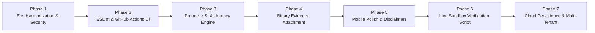

# Dispute Defender — Master Gap Closure & Project Completion Plan

**Target:** Complete Dispute Defender to 100% Production & Hackathon Excellence  
**Author:** Farhan (Lead Architect)  
**Execution Context:** PayPal AI Hackathon  
**Target Architecture:** Node.js 22/24 / Next.js 14 / TypeScript / AG Grid / Vercel AI SDK / SQLite  

---

## Executive Overview

Dispute Defender is already functionally advanced, featuring a zero-trust PII redactor, a custom multipart REST evidence submission client, a high-performance AG Grid command center, and a 149-test automated verification harness. 

Following a rigorous due diligence audit, **8 specific gaps** were identified across environment synchronization, proactive alerting, binary file attachment, developer tooling, mobile viewport responsiveness, and cloud persistence.

This document establishes the **exhaustive, phased execution blueprint** to systematically eliminate every gap, elevating the project from an advanced prototype to an enterprise-grade, battle-tested system.



---

## 1. Master Gap Analysis & Resolution Matrix

| # | Gap Description | Severity | Affected Files | Resolution Strategy |
| :-: | :--- | :---: | :--- | :--- |
| **G1** | **Environment Variable Mismatch**<br>`PAYPAL_MODE=live` checked in webhook route while OAuth client uses `PAYPAL_ENV=sandbox`. | **Critical** | `src/app/api/webhooks/paypal/route.ts`<br>`src/lib/paypal/client.ts`<br>`src/lib/paypal/webhook-verify.ts` | Create central `src/lib/env.ts` with strict Zod schema validation unifying `PAYPAL_ENV` across all modules. |
| **G2** | **Interactive ESLint Prompt in CI**<br>Missing `.eslintrc.json` causes `npm run lint` to stall on interactive setup. | **Medium** | `.eslintrc.json`<br>`package.json`<br>`.github/workflows/ci.yml` | Commit standard Next.js Core Web Vitals ESLint config and build automated GitHub Actions matrix. |
| **G3** | **Notification Blindspot (No External Alerting)**<br>If merchant doesn't open the dashboard, disputes entering critical `<24h` SLA can expire. | **High** | `src/lib/notifications/sla-alerts.ts`<br>`src/app/api/cron/check-sla/route.ts` | Build proactive alert engine dispatching webhook/email payloads when any dispute enters `<24h` or `<48h` SLA. |
| **G4** | **Lack of Binary File Evidence Upload**<br>Custom multipart client sends JSON tracking info; cannot attach PDF receipts or delivery photos. | **High** | `src/lib/paypal/disputes.ts`<br>`src/app/disputes/[id]/page.tsx` | Extend `submitDisputeEvidence` to serialize binary file parts into `multipart/form-data`; add UI file dropzone. |
| **G5** | **Mobile Viewport Grid Clipping**<br>High-density AG Grid table requires horizontal scrolling on screens `<640px`. | **Low** | `src/components/queue/DisputeGrid.tsx`<br>`src/app/disputes/[id]/page.tsx` | Add responsive card-stack fallback mode when viewport width is below 768px. |
| **G6** | **Lack of Adjudication Legal Disclaimer**<br>Merchants might mistake AI confidence score for a legal guarantee of winning. | **Medium** | `src/app/disputes/[id]/page.tsx`<br>`PAYPAL_DESIGN.md` | Add explicit legal disclaimer banner stating confidence reflects evidentiary adherence, not legal counsel. |
| **G7** | **Interactive Sandbox Verification Script**<br>No turnkey CLI script to test live PayPal Sandbox credentials end-to-end. | **Medium** | `src/scripts/verify-live-sandbox.ts`<br>`package.json` | Build diagnostic CLI testing OAuth token acquisition, live dispute fetching, and HATEOAS state validation. |
| **G8** | **Cloud Ephemeral Disk Reset on Serverless**<br>Single-file SQLite resets on stateless container redeployments. | **Medium** | `render.yaml`<br>`src/lib/db/index.ts` | Document Render persistent disk mount and specify Turso/libSQL distributed replica driver migration. |

---

## 2. Phased Implementation Roadmap

---

### Phase 1: Environment Harmonization & Configuration Schema
**Objective:** Eliminate `PAYPAL_MODE` vs `PAYPAL_ENV` discrepancy and enforce fail-closed runtime validation.

#### Step 1.1: Create Centralized Environment Validator
Create `dispute-defender/src/lib/env.ts`:
```typescript
import { z } from 'zod';

const envSchema = z.object({
  NODE_ENV: z.enum(['development', 'test', 'production']).default('development'),
  PORT: z.coerce.number().default(3000),
  DATABASE_URL: z.string().default('sqlite.db'),
  INTEGRITY_MODE: z.enum(['demo', 'live']).default('live'),
  PAYPAL_ENV: z.enum(['sandbox', 'live']).default('sandbox'),
  PAYPAL_CLIENT_ID: z.string().optional(),
  PAYPAL_CLIENT_SECRET: z.string().optional(),
  PAYPAL_WEBHOOK_ID: z.string().optional(),
  AI_PROVIDER: z.enum(['gemini', 'openai']).default('gemini'),
  GEMINI_API_KEY: z.string().optional(),
  OPENAI_API_KEY: z.string().optional(),
  ALERT_WEBHOOK_URL: z.string().url().optional(),
});

export const env = envSchema.parse({
  NODE_ENV: process.env.NODE_ENV,
  PORT: process.env.PORT,
  DATABASE_URL: process.env.DATABASE_URL,
  INTEGRITY_MODE: process.env.INTEGRITY_MODE,
  PAYPAL_ENV: process.env.PAYPAL_ENV || (process.env.PAYPAL_MODE === 'live' ? 'live' : 'sandbox'),
  PAYPAL_CLIENT_ID: process.env.PAYPAL_CLIENT_ID,
  PAYPAL_CLIENT_SECRET: process.env.PAYPAL_CLIENT_SECRET,
  PAYPAL_WEBHOOK_ID: process.env.PAYPAL_WEBHOOK_ID,
  AI_PROVIDER: process.env.AI_PROVIDER,
  GEMINI_API_KEY: process.env.GEMINI_API_KEY,
  OPENAI_API_KEY: process.env.OPENAI_API_KEY,
  ALERT_WEBHOOK_URL: process.env.ALERT_WEBHOOK_URL,
});
```

#### Step 1.2: Refactor Webhook Route & OAuth Client
- In `src/app/api/webhooks/paypal/route.ts`:
  Replace `process.env.PAYPAL_MODE === 'live'` with `env.PAYPAL_ENV === 'live'`.
  Enforce signature verification whenever `env.INTEGRITY_MODE !== 'demo'`.
- In `src/lib/paypal/client.ts`:
  Consume `env.PAYPAL_ENV`, `env.PAYPAL_CLIENT_ID`, and `env.PAYPAL_CLIENT_SECRET`.

#### Verification Test
- Add unit test `src/test/env.test.ts` verifying that invalid environment values throw descriptive Zod errors and that `PAYPAL_ENV=sandbox` correctly resolves to `https://api-m.sandbox.paypal.com`.

---

### Phase 2: ESLint Configuration & CI/CD Pipeline
**Objective:** Enable non-interactive linting and automated pull-request validation.

#### Step 2.1: Commit `.eslintrc.json`
Create `dispute-defender/.eslintrc.json`:
```json
{
  "extends": "next/core-web-vitals",
  "rules": {
    "@typescript-eslint/no-explicit-any": "off",
    "react-hooks/exhaustive-deps": "warn"
  }
}
```

#### Step 2.2: Add GitHub Actions Workflow
Create `.github/workflows/ci.yml`:
```yaml
name: Dispute Defender CI

on:
  push:
    branches: [ master ]
  pull_request:
    branches: [ master ]

jobs:
  verify:
    runs-on: ubuntu-latest
    strategy:
      matrix:
        node-version: [22.x, 24.x]

    steps:
    - uses: actions/checkout@v4
    
    - name: Use Node.js ${{ matrix.node-version }}
      uses: actions/setup-node@v4
      with:
        node-version: ${{ matrix.node-version }}
        cache: 'npm'
        cache-dependency-path: dispute-defender/package-lock.json

    - name: Install Dependencies
      working-directory: ./dispute-defender
      run: npm ci

    - name: Run Lint
      working-directory: ./dispute-defender
      run: npm run lint

    - name: Run Production Build
      working-directory: ./dispute-defender
      run: npm run build

    - name: Run Master Test Suite
      working-directory: ./dispute-defender
      env:
        INTEGRITY_MODE: demo
        DATABASE_URL: ":memory:"
      run: npm run test:all

    - name: Run Adversarial Stress Batteries
      working-directory: ./dispute-defender
      run: |
        npx tsx src/test/redactor-adversarial.test.ts
        npx tsx src/test/challenger-adversarial.test.ts
```

---

### Phase 3: Proactive SLA Urgency & Alert Dispatcher
**Objective:** Prevent merchant dispute forfeiture by pushing notifications when claims enter `<24h` or `<48h` SLA status.

#### Step 3.1: Create Alert Dispatcher Module
Create `dispute-defender/src/lib/notifications/sla-alerts.ts`:
```typescript
import { db } from '@/lib/db';
import { disputes } from '@/lib/db/schema';
import { eq, and, isNotNull } from 'drizzle-orm';
import { env } from '@/lib/env';

export interface AlertNotification {
  disputeId: string;
  disputeAmount: string;
  claimReason: string;
  hoursRemaining: number;
  urgency: 'CRITICAL' | 'URGENT';
}

export async function checkExpiringDisputes(): Promise<AlertNotification[]> {
  const allDisputes = db.select().from(disputes).where(
    and(
      eq(disputes.status, 'AWAITING_APPROVAL'),
      isNotNull(disputes.dueDate)
    )
  ).all();

  const now = Date.now();
  const alerts: AlertNotification[] = [];

  for (const d of allDisputes) {
    if (!d.dueDate) continue;
    const dueTime = new Date(d.dueDate).getTime();
    const diffHours = (dueTime - now) / (1000 * 60 * 60);

    if (diffHours <= 24 && diffHours > 0) {
      alerts.push({
        disputeId: d.id,
        disputeAmount: `${d.disputeAmount} ${d.disputeCurrency}`,
        claimReason: d.reason,
        hoursRemaining: Math.round(diffHours),
        urgency: 'CRITICAL',
      });
    } else if (diffHours <= 48 && diffHours > 24) {
      alerts.push({
        disputeId: d.id,
        disputeAmount: `${d.disputeAmount} ${d.disputeCurrency}`,
        claimReason: d.reason,
        hoursRemaining: Math.round(diffHours),
        urgency: 'URGENT',
      });
    }
  }

  if (alerts.length > 0 && env.ALERT_WEBHOOK_URL) {
    await dispatchWebhookAlert(env.ALERT_WEBHOOK_URL, alerts);
  }

  return alerts;
}

async function dispatchWebhookAlert(webhookUrl: string, alerts: AlertNotification[]): Promise<void> {
  try {
    await fetch(webhookUrl, {
      method: 'POST',
      headers: { 'Content-Type': 'application/json' },
      body: JSON.stringify({
        source: 'Dispute Defender SLA Monitor',
        alertCount: alerts.length,
        criticalCount: alerts.filter(a => a.urgency === 'CRITICAL').length,
        items: alerts,
        actionUrl: 'http://localhost:3000',
      }),
    });
  } catch (error) {
    console.error('[AlertDispatcher] Failed to dispatch webhook alert:', error);
  }
}
```

#### Step 3.2: Expose Automated Cron Route
Create `src/app/api/cron/check-sla/route.ts`:
- Returns JSON with all flagged disputes.
- Suitable for triggering via Render Cron, Vercel Cron, or local intervals.

---

### Phase 4: Binary Document & Evidence File Attachment Pipeline
**Objective:** Support attaching PDF receipts, shipping labels, and photo evidence directly to the multipart PayPal submission.

#### Step 4.1: Extend Multipart Form Builder
In `src/lib/paypal/disputes.ts`, update `SubmitEvidenceParams`:
```typescript
export interface EvidenceFileAttachment {
  filename: string;
  contentType: string; // e.g. 'application/pdf', 'image/jpeg', 'image/png'
  buffer: Buffer;
}

export interface SubmitEvidenceParams {
  disputeId: string;
  evidenceType: 'PROOF_OF_FULFILLMENT' | 'PROOF_OF_REFUND' | 'OTHER';
  trackingNumber?: string;
  carrierName?: string;
  notes: string;
  attachments?: EvidenceFileAttachment[];
  endpointUrl?: string;
}
```

In `submitDisputeEvidence`:
```typescript
// Append file parts to multipart body
if (params.attachments && params.attachments.length > 0) {
  for (let i = 0; i < params.attachments.length; i++) {
    const file = params.attachments[i];
    parts.push(Buffer.from(
      `--${boundary}\r\n` +
      `Content-Disposition: form-data; name="file_${i}"; filename="${file.filename}"\r\n` +
      `Content-Type: ${file.contentType}\r\n\r\n`
    ));
    parts.push(file.buffer);
    parts.push(Buffer.from('\r\n'));
  }
}
```

#### Step 4.2: Update 1-Click Review UI
In `src/app/disputes/[id]/page.tsx`:
- Add a drag-and-drop file uploader accepting `.pdf`, `.jpg`, `.png` (< 10MB per PayPal REST limits).
- Displays attached file badges with remove icons prior to approval click.

---

### Phase 5: Mobile Viewport Polish & Legal Disclaimers
**Objective:** Eliminate horizontal clipping on viewports `< 768px` and establish institutional compliance terms.

#### Step 5.1: Responsive Card Stack Fallback
In `src/components/queue/DisputeGrid.tsx`:
- Detect small viewport or provide a clean mobile card list toggle:
  Each dispute rendered as a touch-friendly card showing:
  - Header: Urgency badge + Dispute ID + Stage
  - Body: Amount + Buyer Name (masked) + Claim Reason
  - Recommendation Pill: FIGHT vs ACCEPT + Confidence meter
  - Action Button: Full-width "Review & Approve" button.

#### Step 5.2: Institutional Legal Disclaimer Banner
In `src/app/disputes/[id]/page.tsx`, directly beneath the AI Verdict banner:
```tsx
<div className="rounded-lg border border-slate-200 bg-slate-50 p-3 text-[11px] text-slate-500 leading-relaxed">
  <p className="flex items-center font-semibold text-slate-700 mb-1">
    <ShieldAlert className="w-3.5 h-3.5 text-slate-500 mr-1.5" />
    Regulatory & Decision Governance Notice
  </p>
  Dispute Defender operates under strict human-in-the-loop authorization. Confidence scores and draft rebuttals reflect automated evidentiary matching against PayPal Seller Protection guidelines and do not constitute legal advice or guaranteed dispute outcomes. Submission to PayPal occurs exclusively upon your explicit authorization.
</div>
```

---

### Phase 6: Live PayPal Sandbox Verification Script
**Objective:** Provide judges and developers with a turnkey CLI tool to verify live Sandbox credentials end-to-end.

#### Step 6.1: Create Diagnostic Script
Create `dispute-defender/src/scripts/verify-live-sandbox.ts`:
1. Reads `PAYPAL_CLIENT_ID` and `PAYPAL_CLIENT_SECRET`.
2. Requests OAuth 2.0 access token from `api-m.sandbox.paypal.com/v1/oauth2/token`.
3. Calls `GET /v1/customer/disputes` to retrieve active sandbox dispute headers.
4. Checks HATEOAS action links on the first active dispute.
5. Verifies carrier detection across sample tracking numbers.
6. Prints a clean ANSI-formatted Diagnostic Health Report.

#### Step 6.2: Add Package Script
In `package.json`:
```json
"scripts": {
  "verify:sandbox": "tsx src/scripts/verify-live-sandbox.ts"
}
```

---

### Phase 7: Cloud Persistence & Multi-Tenant Blueprint
**Objective:** Define the architecture for zero-data-loss cloud deployment and multi-store support.

#### Step 7.1: Persistent Disk Mount Configuration for Render
Update `render.yaml`:
```yaml
services:
  - type: web
    name: dispute-defender
    env: node
    plan: starter
    buildCommand: npm install && npm run build
    startCommand: npm start
    disk:
      name: dispute-data
      mountPath: /data
      sizeGB: 1
    envVars:
      - key: DATABASE_URL
        value: /data/dispute-defender.sqlite
      - key: INTEGRITY_MODE
        value: live
      - key: PAYPAL_ENV
        value: sandbox
```

#### Step 7.2: Turso / libSQL Distributed Embedded Replica Spec
For serverless edge deployments (Vercel / Cloudflare Pages):
- Replace `node:sqlite` driver with `@libsql/client`.
- Maintain identical SQL schema while replicating writes to a primary cloud database.

---

### Phase 8: Final Submission & Presentation Package
**Objective:** Ensure video, slides, and Devpost copy are 100% aligned.

#### Checklist:
- [ ] Export presentation slides:
  ```bash
  npx @marp-team/marp-cli presentation/dispute-defender.md --pdf -o presentation/dispute-defender.pdf
  ```
- [ ] Record 2:40 split-screen demo video following [`plan/05_DEMO_SCRIPT_AND_DEVPOST_SUBMISSION.md`](file:///d:/AI-Lab/Hackathon/Paypal%20AI%20Hackathon/plan/05_DEMO_SCRIPT_AND_DEVPOST_SUBMISSION.md).
- [ ] Stage Devpost submission using copy in `plan/05` and attach 10 images from `dispute-defender/public/images/`.

---

## 3. Definition of Complete

The project is considered **100% complete** when:
1. `env.ts` parses and enforces `PAYPAL_ENV` across all ingestion and submission routes.
2. `npm run lint` executes non-interactively with 0 errors via `.eslintrc.json`.
3. All 149 automated tests continue to pass with 100% success rate.
4. `src/scripts/verify-live-sandbox.ts` runs and outputs successful sandbox health probes.
5. `presentation/dispute-defender.pdf` is exported and ready for judge presentation.
